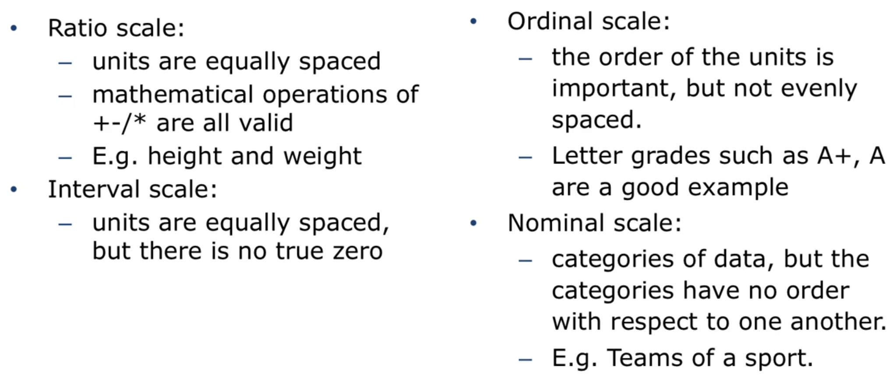
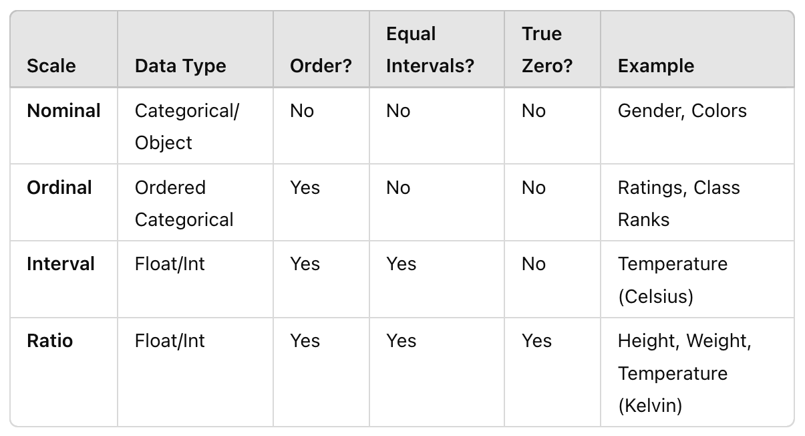

# Machine Learning with Python

Data Science is the backbone of understanding, analyzing, and making sense of data. Machine Learning, a subset of Data Science, takes it one step further by enabling computers to learn from this data, identify patterns, and make decisions with minimal human intervention.

## Introduction to Data Science

### Introduction to Course

- What is it?

  - Mathematics: The abstract study of numbers, quantities, and shapes used to model and solve real-world problems (Sum, Division, and etc.)
  - Statistics: A branch of mathematics that deals with data collection, analysis, interpretation, and presentation (Average, Standard Division, and etc.)
  - Computer Science: The study of computational systems, algorithms, and the design of software and hardware (Calculator)
  - Data Science: The interdisciplinary field that `combines` `statistics`, `mathematics`, and `computer science` to extract insights from data (what products will sell best during the holiday season, income)
  - Data Mining: The process of discovering patterns and relationships in large data sets using algorithms (Social media and positive reviews)
  - Data Analytics: The process of examining data sets to draw conclusions and make informed decisions (tailor workout recommendations to boost participation)
  - Artificial Intelligence (AI): The `simulation of human` intelligence in machines that can perform tasks like decision-making, language processing, and problem-solving (A virtual assistant)
  - Machine Learning: A subset of AI that enables systems to learn from data and improve over time without explicit programming (suggest new movies they might enjoy, and etc.)
  - Deep Learning: A specialized subset of machine learning using `neural networks` to model complex patterns and make `high-level decisions` from `large data sets` (face recognition)
  -
  - 
  -

- The Path(Key Information)

  - Introduction to Data Science

    - Data Science involves extracting `insights` from data using a mix of `statistical method`s, `data analysis`, and `domain knowledge`
    - Core concepts:
      - `Data Collection`: Sources (structured/unstructured data) and methods
      - `Data Cleaning`: Handling missing values, data transformation, and ensuring quality
      - `Exploratory Data Analysis (EDA)`: Visualizing data, understanding patterns, and initial insights
      - `Feature Engineering`: Preparing raw data for use in Machine Learning algorithms
    - Tools and Technologies:
      - Python libraries like `Pandas`, `NumPy`, and `Matplotlib`

  - Connecting Data Science with Machine Learning
    - Machine Learning is the next logical step after mastering Data Science. Once you can work with data (collect, clean, and analyze), Machine Learning allows you to build models that can predict future trends or automate decision-making
    - Why Data Science is essential for Machine Learning:
      - Understanding and preparing the data are crucial to the success of Machine Learning models
      - Data Science provides the skills for transforming raw data into features that Machine Learning algorithms can utilize
  - Introduction to Machine Learning
    - Machine Learning is the science of teaching computers to perform tasks by learning from data, rather than being explicitly programmed
    - Types of Machine Learning:
      - `Supervised Learning`: Learning from labeled data (e.g., classification and regression tasks)
      - `Unsupervised Learning`: Learning from unlabeled data (e.g., clustering and association)
      - `Reinforcement Learning`: Learning through interactions with an environment (e.g., game playing or robotics)
    - Key Algorithms:
      - `Linear Regression`, `Decision Trees`, `Neural Networks`, and `Support Vector Machines`
    - Python libraries: `Scikit-learn`, `TensorFlow`, `Keras`, `PyTorch`
  - Why Learn Data Science and Machine Learning?

    - `High Demand in the Job Market`: Data Scientists and Machine Learning Engineers are among the most sought-after professions in technology, finance, healthcare, and many other industries
    - `Diverse Applications`:

      `In healthcare`: Predicting diseases, personalized treatments.
      `In finance`: Fraud detection, stock market predictions.
      `In technology`: Self-driving cars, virtual assistants (e.g., Siri, Alexa)

    - `Problem-Solving and Automation`: You will learn how to automate processes, make predictions, and solve real-world problems by leveraging data

- Why Python?

  - `First`, it's `easy to learn`: Python is now the language of choice for introducing university students to programming
  - `Second`, it's `full featured`: Python is a very general programming language with a lot of built-in libraries and excels at manipulating data, network programming, and databases
  - `Finally`, Python has a significant set of `data science libraries` one can use: The base of these is called the `SciPy` Ecosystem

- Part one OutLine

  - Prerequisite Python Knowledge
  - The `Pandas` Toolkit
  - Advanced querying and manipulating with `Pandas`
  - Basics statistical analysis with `numpy` and `scipy`, and project

- About `Pandas`

  - several important aspects of the Pandas library, which is fundamental for data manipulation in Python. Key points include:

    - `Data Structures`: Introduction to the two main data structures in Pandas: Series and DataFrames

      - `Series`: A one-dimensional array that holds data of any type
      - `DataFrame`: A two-dimensional table-like structure similar to spreadsheets

    - `Data Manipulation`: How to perform common data manipulation tasks such as:

      - Loading data from `CSV` files using `pd.read_csv()`
      - `Filtering` and `selecting` data using `conditions` and `indexing`

    - `Data Cleaning`: Techniques for cleaning and preparing data, including:

      - `Handling missing` values `(NaN)` using functions like `dropna()` and `fillna()`
      - Renaming columns and restructuring DataFrames

    - `Applying Functions`: Introduction to `apply()` method for transforming data. This allows the application of functions over rows or columns efficiently

    - `Group By Operations`: Demonstration of how to use `groupby()` to aggregate data, which is particularly useful for summarizing data by categories

    - `Merging and Joining`: Basics of `merging` and `joining` different DataFrames, which is crucial for combining datasets

- Brief About Jupyter Notebook System

  - Talk about `Jupyter` NoteBook
  - Install Jupyter NoteBook using `pip` tool
  - Test some Python sample code in Notebook
  - Talk about Jupyter NoteBook tools and ecosystem
  - Talk about Server component and markdown ability
  - Open Jupyter NoteBook inside the terminal and check some codes

- The Python Programming Language: Functions

  - Python is a interpretation language and interpreter execute its code line by line
  - Start by writing a simple function in your Jupyter NoteBook (`add_numbers`)
  - Remember, Python is a Dynamically type language
  - Jupyter NoteBook execute your code by sending it to the machine in the cloud
  - Python doesn't need any keyword for declaring a variable
  - Python `None` is equal to `null` in JS (absence of a value)
  - After executing a cell at the end of NoteBook a new cell will be created
  - Changing in one cell doesn't change any result in other cells befor running them again
  - Write add_numbers function in more complex way
  - In python we can assign a function to a variable

- The Python Programming Language: Types and Sequences

  - `type` can return data or function as output
  - We have three primitive type in Python
    - Number
    - String
    - Boolean
  - We are going to talk about three sequence or collection (Complex data structure) in Python
    - List
    - Tuple
    - Dictionary
  - Talk about primitive Types
  - Talk about Tuple
  - Talk about List
  - Using `append()` function fo a list
  - Loop over a list using for and while (index)
  - Mathematical operators on lists
  - Use the `in` operator to check if something is inside a list.
  - Use bracket notation to slice a string
  - `list[-1]` return the last element of the string
  - `[:]` slicing is core to the Python Programming Language
  - Slicing is going to be used in regular expression topic in text Mining
  - We can concatenate two string using `+` operator
  - Talk about `split()` method. `split` returns a list of all the words in a string, or a list split on a specific character.
  - Make sure you convert objects to strings before concatenating.
  - Dictionaries are labeled and unordered data structures
  - Retrieve a value by using the indexing operator
  - Assign new item to the Dictionary
  - Iterate over all of the keys
  - Iterate over all of the values / Iterate over all of the items in the list
  - You can unpack a sequence into different variables
  - Make sure the number of values you are unpacking matches the number of variables being assigned.

- The Python Programming Language: More on Strings

  - In python 3 strings are `unicode` (`UTF`) based (note limited 0-256 characters)
  - Python 3 use it by default
  - Python has a built in method for convenient string formatting
  - Use format string method in the form of `placeholder` and its normal shape
  - String manipulation is a big part of `data cleaning`

- Python Demonstration: Reading and Writing CSV files

  - Iterating through a .CSV file to create a Dictionary
  - Use iPython magic command `precision` to format floating point number for print
  - `csv.Dictreader` convert our csv file content to a list of dictionaries
  - `len` shows that our list is comprised of 234 dictionaries
  - `keys` gives us the column names of our csv
  - Similarly this is how to find the average hwy fuel economy across all cars
  - All values saved in the format of string inside the dictionary so we need to convert it to float and then we can sum all values together
  - Also we can make a `set` of values of a specific field
  - Do a complex example where we are grouping the cars by number of cylinder, and finding the average cty mpg for each group
  - Use `set` to return the unique values for the class types in our dataset
  - Do above example for highway field
  - We can do all above things with `pandas` library in the easy way

- The Python Programming Language: Dates and Times

  - Lots of analysis you do relate to dates and times
  - Dates and times can be saved in many different ways
  - `time` returns the current time in seconds since the Epoch. (`January 1st, 1970`)
  - Convert the timestamp to datetime using `.fromtimestamp` method
  - Talk about Handy datetime attributes
  - `timedelta` is a duration expressing the difference between two dates

- The Python Programming Language: Objects and map()

  - Talk about classes in Python and Object Oriented Programming (OOP)
  - Add a constructor is not necessary
  - An example of a class in python
  - The map function is one of the basis for functional programming in python
  - `Functional programming` in Python is a paradigm that treats computation as the evaluation of mathematical functions. It focuses on avoiding changing states and mutable data, relying instead on pure functions that return new data `without modifying the input`
    - `Pure Functions`: Functions that give the same output for the same input without side effects
    - `Higher-Order Functions`: Functions that can take other functions as arguments or return them, such as `map()`, `filter()`, and `reduce()`
    - The `map()` function in Python is used to apply a given `function` to all items in an `iterable` (like a list or tuple) and return a `map object` (which is an iterator) containing the results
    - `map(function, iterable)`
    - Example of mapping two lists (It returns object which is useful in dealing with big data) (`lazy evaluation`)

- The Python Programming Language:  Lambda and List Comprehensions

  - A lambda function is a one-line anonymous function that we can pass to other functions
  - Lambda function structure: `lambda parameter: expression`
  - Lambdas are really much more limited than full function definition
  - The return of a lambda is a function reference
  - They are very useful for simple little data cleaning tasks
  - Talk about list Comprehensions

### Numerical Python Library (NumPy)

- NumPy

  - `Numpy` is the fundamental package for numeric computing with Python
  - We will talk about creating array with certain data types, manipulating array, selecting elements from arrays, and loading dataset into array
  - `pandas` is a part of `Numpy` and it has a `high-performance data-centric` package
  - In this part we talk about creating, manipulating, selecting, and loading a data set into an array
  - Actually `array` is a list of objects
  - To creating a array using pandas library we can use `array()` method
  - `ndim` attribute return the dimension of our array
  - Passing a list of list, create a `multi-dimension` array
  - We can print out the length of each dimension by calling the `shape` attribute, which returns a tuple
  - We can also check the type of items in the array by using `dtype` attribute
  - `Array` method accepts all kind of valid data type as input
  - Note that numpy automatically converts integers, like 5, up to floats, since there is no loss of precision
  - Numpy will try and give you the best data type format possible to keep your data types `homogeneous`, which means all the same, in the array
  - Sometimes we know the shape of an array that we want to create, but not what we want to be in it. `numpy` offers several functions to create arrays with initial placeholders, such as `zero's` or `one's`
  - We can also generate an array with random numbers
  - You'll see zeros, ones, and rand used quite often to create example arrays, especially in `stack-overflow` posts and other forums
  - We can also create a sequence of `numbers` in an array with the `arrange()` function
  - If we want to generate a sequence of `floats`, we can use the `linspace()` function
  - the third argument is the total number of items you want to generate
  - We can do many things on arrays, such as `mathematical manipulation` (addition, subtraction, square, exponents)
  - We can also do `matrix manipulation` such as `product`, `transpose`, `inverse`, and so forth
  - We can apply an operator on an array, and a `boolean array` will be returned for any element in the original, with True being emitted if it meets the condition and False otherwise
  - Do it for checking items in the case of being even or odd
  - If we want to do `elementwise product`, we use the `"*"` sign
  - If we want to do `matrix product`, we use the `"@"` sign or use the `dot` function
  - When manipulating arrays of different types, the type of the resulting array will correspond to the more general of the two types. This is called `upcasting`
  - `Numpy` arrays have many interesting `aggregation functions` on them, such as `sum()`, `max()`, `min()`, and `mean()`
  - or two dimensional arrays, we can do the same thing for each row or column
  - By using `reshape()` method we can make multidimensional array
  - We can load an image as matrix in notebook using numpy and manipulate it
  - If we just wanted to invert this image we could use the numpy array to do so
  - We can create a large shape image using `full` method which its items all to be the same

- Indexing, Slicing and Iterating

  - `Indexing`, `slicing` and `iterating` are extremely important for data manipulation and analysis because these techinques allow us to select data based on conditions, and copy or update data
  - A one-dimensional array, works in similar ways as a list.To get an element in a one-dimensional array, we simply use the offset index
  - For multidimensional array, we need to use integer array indexing
  - Boolean indexing allows us to select arbitrary elements based on conditions
  - We can then place this array of booleans like a mask over the original array to return a one-dimensional array relating to the true values
  - Slicing is a way to create a sub-array based on the original array
  - For slicing we use `:`
  - Slicing in one dimensional array and list are completely the same
  - Slicing in two dimensional array is different and first argument is for rows and the second argument is for columns
  - Modifying the sub array will consequently modify the original array

- Trying Numpy with Datasets

  - To load a dataset in Numpy, we can use the `genfromtxt()` function
  - We can specify data file name, delimiter (which is optional but often used), and number of rows
  - The genfromtxt() function has a parameter called `dtype` for specifying data types of each column
  - Without specifying the types, all types will be casted the same to the more general/precise type
  - Also remember that for multidimensional arrays, the first argument refers to the row, and the second argument refers to the column, and if we just give one argument then we'll get a single dimensional list
  - But if we wanted the same values but wanted to preserve that they sit in their own rows we would write `wines[:, 0:1]`
  - We can then call the aggregation functions on this data

- Manipulating Text with Regular Expression/span>
- Actually regular expression is a pattern which you give to a regex processor with some source data. The processor then parses that source data using that pattern, and returns chunks of text back to the a data scientist or programmer for further manipulation
- There's really three main reasons you would want to do this:
  - to check whether a pattern exists within some source data
  - to get all instances of a complex pattern from some source data
  - to clean your source data using a pattern generally through string splitting.
- Regexes are not trivial, but they are a foundational technique for data cleaning in data science applications, and a solid understanding of regexs will help you quickly and efficiently manipulate text data for further data science application
- First we'll import the `re` module
- To checking for conditionals, we can segment a string by tokenizing
- The regex specification standard defines a markup language to describe patterns in text:
- Lets start with anchors.
- Anchors specify the start and/or the end of the string that you are trying to match
- The caret character `^` means start
- The dollar sign character `$` means end

- Patterns and Character Classes
- Talk more about patterns and start with character classes
- You can also include a `range of characters`, which are ordered alphanumerically
- You can write this pattern by using the `pipe` operator, which means `OR`
- We can use the `caret` with the set operator to negate our results

- Quantifiers
- `Quantifiers` are the number of times you want a pattern to be matched in order to match
- quantifier is expressed as `e{m,n}`, where e is the expression or character we are matching, `m` is the `minimum number` of times you want it to matched, and `n` is the `maximum number` of times the item could be matched
- It's important to note that the regex quantifier syntax does not allow you to deviate from the {m,n} pattern
- we can use `\w` to match any letter, including digits and numbers
- We can use an asterisk `*` to match 0 or more times

- Groups
- you can actually match different patterns, called groups, at the same time, and then refer to the groups you want
- we've seen that `findall()` returns strings, and `search()` and `match()` return individual Match objects
- We use the function `finditer()` if we want a list of Match objects
- We can get an individual group using `group(number)`
- we can print out the whole dictionary for the item too, and see that the `[edit]` string is still in there
- For that we use the syntax `(?P<name>)`, where the parenthesis starts the group, the `?P` indicates that this is an extension to basic regexes, and `<name>` is the dictionary key we want to use wrapped in `<>`
- We can get the dictionary returned for the item with `.groupdict()`

- Look-ahead and Look-behind
- We can isolate text which comes before the `[edit]` rendering, but we actually don't care about the `[edit]` text itself

- Example: Wikipedia Data
- The `verbose` mode allows you to write multi-line regexes and increases readability
- This means we can write our regex a bit more like code, and can even include comments with
- Now when we call `finditer()` we just pass the `re.VERBOSE` flag as the last parameter

- Example: New York Times and Hashtags
- So lets create a pattern. We want to include the hash sign first, then any number of alphanumeric characters. And we end when we see some whitespace

- Part Two Reading Assignments (Optional)
- Python for Data Analysis by Wes McKinney (O’Reilly). Copyright 2017 Wes McKinney, 978-1-491-95766-0.

  - Chapter Five: Getting started with pandas

  - Chapter Seven: Data Cleaning and Preparation

### Pandas

- Introduction to Pandas

  - The pandas library is a powerful, open-source tool in Python designed for data manipulation and analysis
  - It provides data structures, mainly the DataFrame and Series, to handle large datasets and perform operations such as cleaning, transforming, and analyzing data efficiently
  - Pandas was created by `Wes McKinney` in 2008, and is an open source project under a very permissive license
  - I want to take a moment here to introduce the question answersing site Stack Overflow. Stack Overflow is used broadly within the software development community to post questions about programming, programming languages, and programming toolkits
  - In 2012 Wes McKinney wrote the definitive Pandas reference book called `Python for Data Analysis` and published by `O'Reilly`, and it's recently been update to a second edition. I consider this the go to book for understanding how Pandas works

- The Series Data Structure

  - The series is one of the core data structures in pandas
  - You think of it a cross between a list and a dictionary
  - The items are all stored in an order and there's labels with which you can retrieve them
  - As you might expect, you can create a series by passing in a list of values. When you do this, Pandas automatically assigns an index starting with zero and sets the name of the series to None. Let's work on an example of this
  - Now we just call the `Series` function in pandas and pass in the students
  - We see here that the pandas has automatically identified the type of data in this Series as "object" and set the `dytpe` parameter as appropriate
  - The most important is how Numpy and thus pandas handle missing data
  - pandas does some type `conversion`. If we create a list of strings and we have one element, a None type, pandas inserts it as a None and uses the type object for the underlying array
  - if we create a list of numbers, integers or floats, and put in the None type, pandas automatically converts this to a special floating point value designated as `NaN`, which stands for `"Not a Number"`
  - So when you're wondering why the list of integers you put into a Series is not floats, it's probably because there is some missing data
  - `NaN` is `*NOT* equivalent` to `None` and when we try the equality test, the result is False
  - You need to use special functions to test for the presence of not a number, such as the Numpy library `isnan()`
  - A series can be created directly from `dictionary` data
  - Once the series has been created, we can get the index object using the `index` attribute
  - We can create a more complex type of data, say, a list of tuples
  - if your list of values in the `index` object are `not aligned` with the `keys` in your dictionary, pandas overrides the automatic creation to favor only and all of the indices values that you provided

- Querying a Series

  - A pandas Series can be queried either by the index position or the index label
  - To query by numeric location, starting at zero, use the `iloc` `attribute`
  - To query by the index label, you can use the `loc` `attribute`
  - If you pass in an `integer` parameter, the operator will behave as if you want it to query via the `iloc` attribute
  - If you pass in an `object`, it will query as if you wanted to use the label based `loc` attribute
  - To pass a list of integers the safer option is to be more explicit and use the iloc or loc attributes directly
  - Use `numpy` in the case of trying to find a certain number, or summarizing data or transforming the data in some way
  - The `ipython` interpreter has something called `magic functions` begin with a percentage (`%`) sign
  - If we type this sign and then hit the Tab key, you can see a list of the available magic functions
  - Note that in order to use a cellular magic function, it has to be the first line in the cell
  - `Vectorization` is faster than typical coding way
  - A Related feature in pandas and nummy is called `broadcasting`
  - With broadcasting, you can apply an operation to every value in the series, changing the series
  - Pandas does support iterating through a series much like a dictionary, allowing you to `unpack values` easily
  - We can use the `items()` function which returns a label and value
  - The typical mathematical operations you would expect are vectorized, and the numpy documentation outlines what it takes to create vectorized functions of your own
  - The `.loc` attribute lets you not only modify data in place, but also add new data as well
  - We can append all of the data in this new Series to the first using the `._append()`
  - the append method doesn't actually change the underlying Series objects, it instead returns a new series which is made up of the two appended together
  - when we query the appended series for `Ali`, we don't get a single value, but a `series` itself

- The DataFrame

  - The DataFrame data structure is the heart of the Panda's library
  - It's a primary object that you'll be working with in data analysis and cleaning tasks
  - The DataFrame is conceptually a `two-dimensional` series object, where there's an index and multiple columns of content, with each column having a label
  - In the first method of creating a DataFrame we can create series and use theme with indexes
  - We can pass in our index values as a second arguments
  - An alternative method is that you could use a list of dictionaries, where each dictionary represents a row of data
  - Similar to the series, we can extract data using the `.iloc` and `.loc` attributes
  - Because the DataFrame is two-dimensional, passing a single value to the loc indexing operator will return `the series` if there's only one row to return
  - Remember that the indices and column names along either axes horizontal or vertical, could be `non-unique`
  - In Panda's DataFrame you can quickly select data based on multiple axes
  - We could `transpose` the matrix. This pivots all of the rows into columns and all of the columns into rows, and is done with the `T` attribute
  - Panda reserves the indexing operator directly on the DataFrame for column selection
  - You get a key error if you try and use `.loc` with a column name
  - you can `chain operations` together
  - Chaining, by indexing on the return type of another index, can come with some `costs` and is best `avoided` if you can use another approach
  - Chaining tends to cause Pandas to return a copy of the DataFrame instead of a view on the DataFrame
  - `.loc` does row selection, and it can take two parameters, the row index and the list of column names. The .loc attribute also supports `slicing`
  - It's easy to delete data in Series and DataFrames, and we can use the `drop` function to do so
  - The drop function doesn't change the DataFrame by default
  - `Drop` has two optional parameters:
    - The first is called `inplace`, and if it's set to true, the DataFrame will be updated in place, instead of a copy being returned
    - The second parameter is the `axes`, which should be dropped
  - There is a second way to drop a column, and that's directly through the use of the indexing operator, using the `del` keyword
  - This way of dropping data, however, takes immediate effect on the DataFrame and does not return a view
  - `Adding` a new column to the DataFrame is as easy as assigning it to some value using the indexing operator

- DataFrame Indexing and Loading

  - Use one shell command here called `cat`, for `concatenate`, which just outputs the contents of a file
  - Pandas mades it easy to turn a CSV into a dataframe, we just call `read_csv()`
  - We can set the serial `no.` as the index if we want to by using the `index_col`
  - In Pandas, we can use the `rename()` function It takes a parameter called columns, and we need to pass into a dictionary which the keys are the old column name and the value is the corresponding new column name
  - If some columns don't change we need to make sure we got all the column names correct We can use the columns attribute of dataframe to get a list
  - Python comes with a handy string function to strip white space called `strip()`
  - When we pass this in to rename we pass the function as the `mapper` parameter, and then indicate whether the axis should be columns or index (row labels)
  - The rename function isn't modifying the DataFrame
  - We can also use the `df.columns` attribute by assigning to it a list of column names which will directly rename the columns
  - This will directly modify the original DataFrame and is very efficient especially when you have a lot of columns and you only want to change a few
  - The CSV is by far the most common data format you'll run into, and an important one to know how to manipulate in pandas

- Querying DataFrame

  - A `Boolean mask` is an array which can be of one dimension like a series, or two dimensions like a data frame, where each of the values in the array are either true or false
  - Boolean masks are created by applying operators directly to the pandas Series or DataFrame objects
  - pandas is applying the comparison operator you specified through `vectorization` (so efficiently and in parallel) to all of the values in the array you specified which
  - Now you need to `hide` the data you don't want, which is represented by all of the False values
  - We do this by using the `.where()` function on the original DataFrame
  - The next step is, if we don't want the NaN data, we use the `dropna()` function
  - created a shorthand syntax which combines `where()` and `dropna()`, doing both at once. And, in typical fashion, the just overloaded the `indexing operator` to do this
  - Indexing operator can be called with a string parameter to project a single column or a list of columns as strings Or you can send it a boolean mask
  - We cannot apply a logical operator on a boolean mask of a DataFrame
  - We can use symbols (`&`, `|`) instead of python form of these logical operators
  - Using parenthesis in logical comparisons are mandatory
  - The problem is that Python is trying to `bitwise` and a 0.7 and a pandas DataFrame, when you really want to bitwise and the broadcasted DataFrames together
  - If we want to apply these statements without parenthesis we can use `.gt` or `.lt` method instead of bitwise operators
  - `50%` or more of the work you'll be doing in data cleaning involves querying DataFrames

- Indexing DataFrame

  - The index is essentially a row level label, and in pandas the rows correspond to axis zero. Indices can either be either autogenerated, such as when we create a new Series without an index, in which case we get numeric values, or they can be set explicitly, like when we use the dictionary object to create the series, or when we loaded data from the CSV file and set appropriate parameters
  - Another option for setting an index is to use the `set_index()` function
  - So we copy the indexed data into its own column Then we set the index to another column
  - We can get rid of the index completely by calling the function `reset_index()`. This promotes the index into a column and creates a default numbered index
  - One nice feature of Pandas is `multi-level indexing`
  - To create a multi-level index, we simply call set index and give it a list of columns that we're interested in promoting to an index
  - we see that the possible values for the sum level are using the `unique()` function on the DataFrame
  - We can creating a list of column names that we want to keep then project those and assign the resulting DataFrame to our df variable
  - We can load the data and set the index to be a combination of the two different columns
  - We do this by creating a list of the column identifiers we want to have indexed. And then calling `set_index()` with this list and assigning the output as appropriate
  - the `loc` attribute of the DataFrame can take multiple arguments. And it could query both the row and the columns. When you use a `MultiIndex`, you must provide the arguments in order by the level you wish to query
  - If you are interested in comparing two counties we can pass a list of tuples describing the indices we wish to query into loc
  - e need to provide two values as each element of our filtering list. Each tuple should have two elements, the first element being the first index and the second element being the second index

- Missing Values

  - Missing values are pretty common in data cleaning activities
  - if you are running a survey and a respondent didn't answer a question the missing value is actually an omission
  - This kind of missing data is called `Missing at Random`
  - There are other variables that might be used to `predict` the variable which is missing
  - If there is no relationship to other variables, then we call this data Missing `Completely at Random (MCAR)`
  - These are just two examples of missing data, and there are many more
    - wasn't collected
    - wouldn't make sense
  - Most missing values are often formatted as `NaN`, `NULL`, `None`, or `N/A`
  - Sometimes missing values are not labeled so clearly
  - The pandas `read_csv()` function has a parameter called `na_values` to let us specify the form of missing values
  - We can actually use the function `.isnull()` to create a boolean mask of the whole DataFrame
  - Another useful operation is to be able to drop all of those rows which have any missing data, which can be done with the `dropna()` function
  - One of the handy functions that Pandas has for working with missing values is the filling function, `fillna()`
  - Note that the `inplace` attribute causes pandas to fill the values inline and does not return a copy of the DataFrame, but instead modifies the DataFrame you have
  - The two common fill values are `ffill` and `bfill`
    - `ffill` is for forward filling and it updates an na value for a particular cell with the value from the previous row
    - `bfill` is backward filling, which is the opposite of `ffill`
  - We can also do customized fill-in to replace values with the `replace()` function
  - To replace using a regex we need to specify three parameter
  - When you use statistical functions on DataFrames, these functions typically ignore missing values
  - For instance if you try and calculate the mean value of a DataFrame, the underlying NumPy function will ignore missing values

- Example: Manipulating DataFrames

  - Start with cleaning up that name into `firstname` and `lastname` using regex
  - First we could make a copy of the President column
  - The `apply()` function on a DataFrame will take some arbitrary function you have written and apply it to either a Series (a single column) or DataFrame across all rows or columns
  - Now we just return the row and the pandas .apply() will take of merging them back into a DataFrame
  - `.extract()` takes a regular expression as input and specifically requires you to set capture groups that correspond to the output columns you are interested in
  - Now the `extract` function is built into the str attribute of the Series object, so we can call it using `Series.str.extract(pattern)`
  - But if we name the groups we get named columns out
  - We can just copy these into our main DataFrame if we want to
  - We need to update this column to the write data type as well

### More Data Processing with Pandas

- Merging

  - We can bring multiple dataframe objects together, either by merging them horizontally, or by concatenating them vertically
  - A Venn Diagram is traditionally used to show set membership
  - In the Venn diagram, `Union` represents everyone in any circle
  - In database terminology, this is called an `outer join`
  - Or in set theory, the `intersection` represented in the Venn diagram as the overlapping parts of each circle (`inner join`)
  - If we want the union of these, we would call `merge()` passing in the DataFrame on the left and the DataFrame on the right and telling merge that we want it to use an outer join
  - If we wanted to get the intersection, that is, just those who are a student AND a staff, we could set the how attribute to `inner`
  - The first is when we would want to get a list of all staff regardless of whether they were students or not. But if they were students, we would want to get their student details as well (`Set Addition`)
  - To do this we would use a `left` join
  - important to note the order of dataframes in this function: the first dataframe is the left dataframe and the second is the right
  - we have a parameter called `on`, and we can assign a column that both dataframe has as the joining column
  - The merge function preserves this information, but appends an `_x` or `_y` to help differentiate between which index went with which column of data
  - The `_x` is always the `left` DataFrame information, and the `_y` is always the `right` DataFrame information
  - Talk about multi-indexing and multiple columns
  - Joining dataframes through merging is incredibly common, and you'll need to know how to pull data from different sources, clean it, and join it for analysis
  - Joining "horizontally", meaning we join on similar values in a column found in two dataframes
  - Concatenating is joining "vertically", meaning we put dataframes on top or at the bottom of each other
  - If you want to suppress some of the jupyter warning messages and just tell read_csv to ignore bad lines start the cell with a cell magic called `%%capture`
  - Let's just put all three dataframes in a list and call that list frames and pass the list into the `concat()` function
  - We pass in a list of keys that we want to correspond to the dataframes into the keys parameter
  - If you are concatenating two dataframes that do not have identical columns, and choose the outer method, some cells will be `NaN`
  - If you choose to do inner, then someobservations will be dropped due to `NaN` values

- Pandas Idioms

  - The best solutions are celebrated as `Idiomatic Python` and there are lots of great examples of this on `StackOverflow` and other websites
  - Panda's community have used the term `pandorable` for these idioms
  - The general idea behind `method chaining` is that every method on an object returns a reference to that object
  - You can condense many different operations on a DataFrame, for instance, into one line or at least one statement of code
  - Here's a more traditional, `non-pandorable` way, of writing this and you might even be able to understand it better as a new person to the language
  - In this case, you can actually time both methods and see which one runs faster
  - Python has a wonderful function called `map`, which is sort of a basis for functional programming in the language
  - Pandas has a similar function called `applymap`
  - In `applymap`, you provide some function which should operate on each cell of a DataFrame, and the return set is itself a DataFrame
  - We are often wanting to `map` across all of the rows in a DataFrame
  - `Apply` takes the `function` and the `axis` on which to operate as parameters
  - To apply across all rows, which is applying on all columns, you pass axis equal to `'columns'`
  - Also we can add two new columns in the original dataframe to store min and max
  - You might chain several apply calls with `lambdas` together to create a readable yet succinct data manipulation script
  - A lambda is just an unnamed function in python, in this case it takes a single parameter, x, and returns a single value

- Group By

  - Sometimes we want to select data based on groups and understand aggregated data on a group level
  - Pandas allows us to iterate over every row in a dataframe, it is generally very slow to do s
  - Pandas has a `groupby()` function to speed up such task
  - The idea behind the `groupby()` function is that it takes some dataframe, splits it into chunks based on some key values, applies computation on those chunks, then combines the results back together into another dataframe (`split-apply-combine pattern`)
  - 99% of the time, you'll use group by on one or more columns. But you can also provide a function to group by and use that to segment your data
  - This time I didn't pass in a column name to `groupby()`
  - To group data by multiple columns, first approach might be to promote them to a `multiindex` and just call `groupby()`
  - Also we can apply conditions and criteria on our grouping policy using functions
  - The pandas developers have three broad categories of data processing to happen during the apply step:
    - `Aggregation` of group data
    - `Transformation` of group data
    - `Filtration` of group data
  - The most straight forward apply step is the aggregation of data, and uses the method `agg()` on the groupby object
  - `agg` we can pass in a dictionary of the columns we are interested in aggregating along with the function we are looking to apply to aggregate
  - `Transformation` is different from aggregation. It broadcasts the function you supply over the grouped dataframe, returning a new dataframe
  - This makes `combining` data later easy
  - The `filter()` function takes in a function which it applies to each group dataframe and returns either a True or a False, depending upon whether that group should be included in the results

- Scales

  - We always talk about different data types and now we need to explain an important terminology called scales
  - We have four different scales here:
    - `Ratio scale`: Represented as float or int types.
    - `Interval Scale`: Represented as float or int types, depending on the data
    - `Ordinal Scale`:Can be represented as an ordered Categorical type
    - `Nominal Scale` :Often represented as a Categorical type or object type
  -
  - 
  -
  - 
  -
  - Pandas has a number of interesting functions to deal with converting between measurement scales
  - We can, however, tell pandas that we want to change the type to category, using the `astype()` function
  - We can tell pandas that the data is ordered by first creating a new categorical data type with the list of the categories (in order) and the `ordered=True flag`
  - We see that the operator works as we would expect. We can then use a certain set of mathematical operators, like `minimum`, `maximum`, etc., on the ordinal data
  - Variables with a boolean value are typically called `dummy` variables, and pandas has a built in function called `get_dummies()` which will convert the values of a single column into multiple columns of `zeros and one`s` indicating the presence of the dummy variable
  - Pandas has a function called `cut()` which takes as an argument some `array-like structure` like a column of a dataframe or a series
  - It also takes a number of `bins ` to be used, and all bins are kept at equal spacing

- Pivot Table

  - A pivot table is a way of summarizing data in a DataFrame for a particular purpose
  - It makes heavy use of the aggregation function. A pivot table is itself a DataFrame, where the rows represent one variable that you're interested in, the columns another, and the cell's some aggregate value
  - First create a new ranke column in your dataframe based on your previous knowledge where institutions with world ranking `1-100` are categorized as `first` tier and those with world ranking `101 - 200` are `second` tier, ranking `201 - 300` are `third` tier, `after 301` is `other` top universities
  - A pivot table allows us to pivot out one of these columns a new column headers and compare it against another column as row indices
  - The `NaN` values indicate that Argentia has only observations in the "Other Top Unversities" category
  - Pivot tables aren't limited to one function that you might want to apply
  - You can pass a named parameter, aggfunc, which is a list of the different functions to apply
  - We can also `summarize` the values within a given top level column
  - A pivot table is just a `multi-level dataframe`, and we can access series or cells in the dataframe in a similar way as we do so for a regular dataframe
